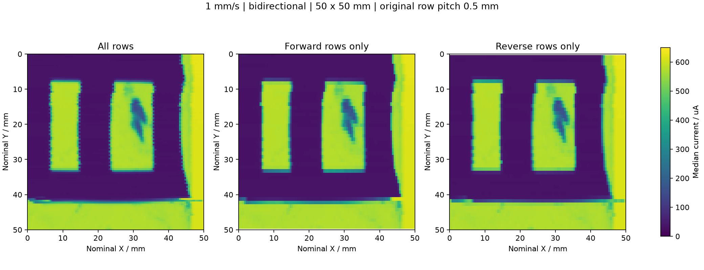
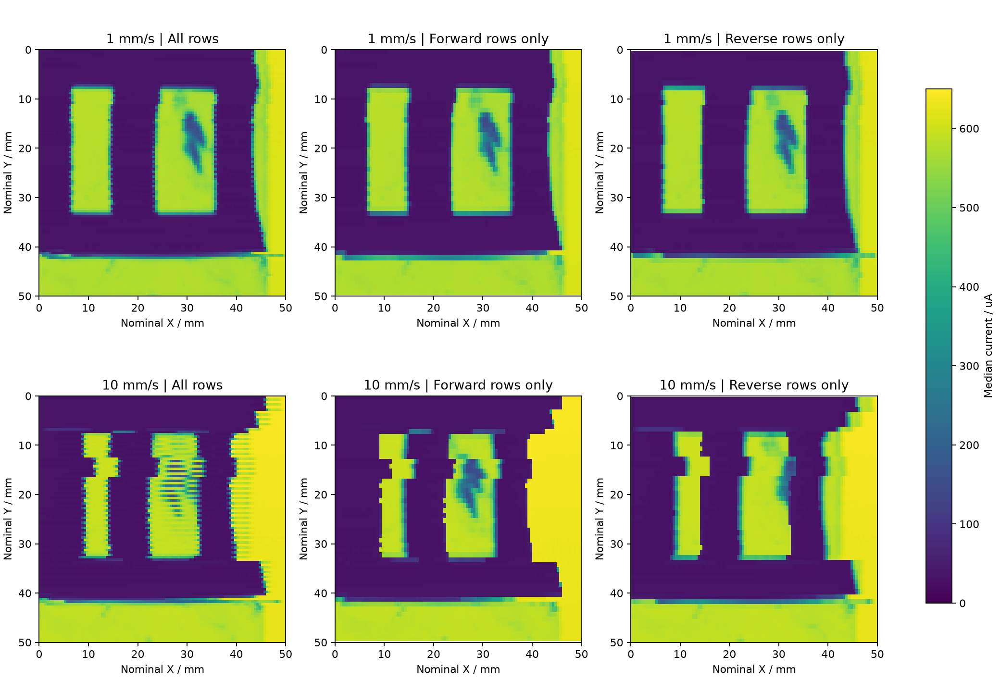

# 1 mm/s双向扫描的正反向拆分

本次对已发布的0928细行距慢速数据进行方向拆分，不调整分行、不重新配准、不平滑、不改变像素电流。每个原像素的中位数已重新从原始区间核对。

设置：双向50×50 mm；Y行距0.5 mm；X和旧程序Y速度均设1 mm/s；100行；423146个原始点；100×100格，每格38–41点。源表界面测量速度0.1，用户后续说明该设置为NPLC。

全部100行、正向50行、反向50行。方向由estimated-row-windows.csv核对，反向行在原重构中已经左右翻转到共同空间方向，本次不再翻转。子图纵向行间距1 mm，横向0.5 mm；保留原Y行中心坐标，显示色块覆盖范围不代表补测数据。

上排1 mm/s，下排10 mm/s；两组同为50×50 mm、0.5 mm行距；色标统一0–650 μA。快组直接读取已发布的原始重构，没有采用探索性相位修正。

## 观察结论

慢速正反向轮廓总体接近，高速明显的交替条纹和方向相关形变显著减弱；慢速仍可见细小边缘差异，不能称为完全消失。右窗口内部暗斑在慢速两个方向中均存在，不应把整个暗斑解释为方向性伪影。

本次是同一慢速测量的拆分，保留全部已选正扫与反扫数据。两个方向位于相邻而非完全相同的Y位置；慢快是不同次测量且旧程序Y速度也随X变化。图像支持“慢速配置的方向相关失真更轻”，不单独证明源表量程或某一硬件机制。

## 数据及复现

- direction_subsets.npz：全部、正向、反向电流矩阵，以及原行号和Y中心。
- forward_current_uA.csv、reverse_current_uA.csv：50×100电流子矩阵。
- forward_rows.csv、reverse_rows.csv：子矩阵与原重构行号对应。
- 复现：在项目根目录运行 `python experiments/2026-09-28/bidirectional-50mm-pitch-0p5mm-speed-1mmps/code/compare_directions.py`。
