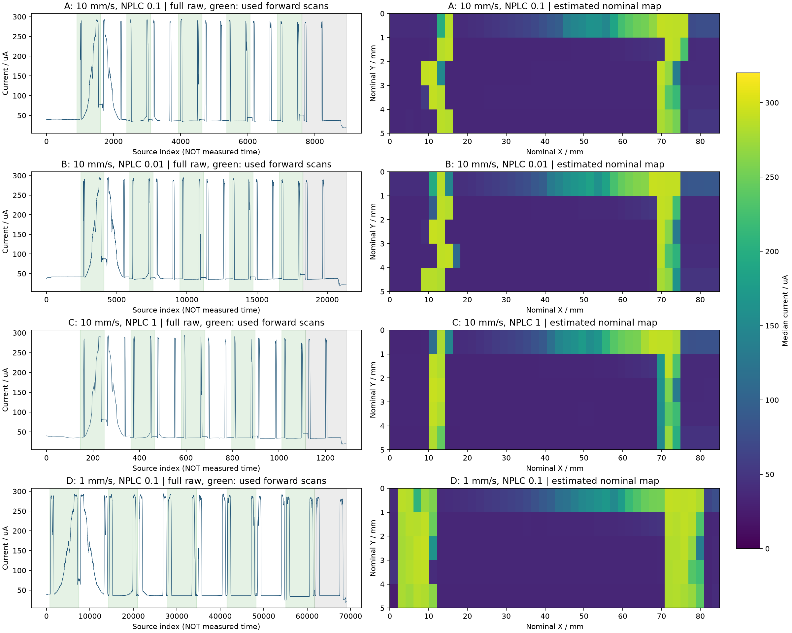
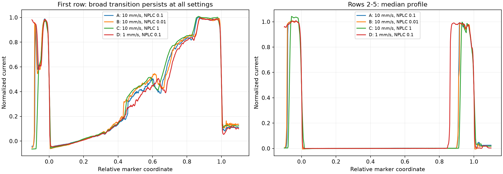
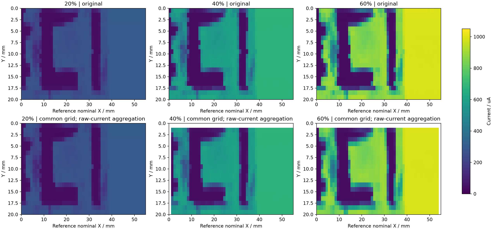
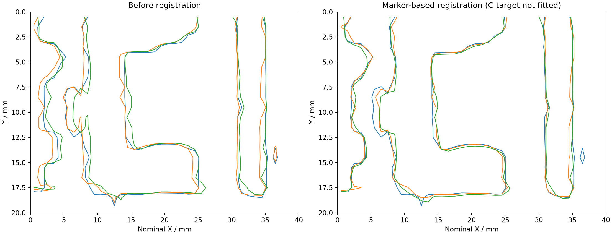

# 2026-10-16：源表采集对照与三次测量对准

> **1017修正：**首行不用于方向性伪影判断；原先以首行宽缓变化为主的论述不能排除后续边缘伪影。请优先阅读[后四行边缘复核](edge-review.md)。

[四个问题的PPT汇报说明](slide-notes.md) · [打开离线图集](index.html) · [共同像素与原始数据交互查看器](comparisons/fusion-viewer.html) · [七组原始文件校验记录](source-manifest.json)

## 结论先读

1. **本批数据不支持把首行大范围渐变主要归因于NPLC或固定时间响应拖尾。** NPLC从0.01到1、速度从10降到1 mm/s，首行空间归一化曲线仍高度相似，后四行则基本为暗平台加窄透光间隔。应优先考虑首行靠近胶带边缘、光斑覆盖、胶带透光/几何、光路或器件空间非均匀性；这些仍是候选解释，未独立验证。
2. **NPLC=1、10 mm/s组的采样稀疏是明确问题。** 约2.02×1 mm的显示像素只有2–3点，某边缘过渡仅约1–2点。NPLC=0.01提供更多采样点，但相较0.1没有显示出明显的边缘锐化。不能把插值画出的平滑线误当成测得的细节。
3. **Marker可用于重复扫描的几何对齐，也可以建立原始数据层的共同网格。** 已提供三通道电流表及每个贡献区间的原始点号、行号、Y权重。C形未参与配准，独立竖边检查显示位置差减小，但整块C区的归一化电流差没有降低；不能声称整图已经无误差融合。
4. **当前仅为不同照明强度的融合可行性验证。** 20%、40%、60%不是偏振分析角度，不能将这三组直接反演为真实斯托克斯参数。

## 一、实验与数据边界

| 实验 | X范围/mm | 正扫行数 | Y行距/mm | X速度/mm/s | NPLC | 原始点数 | 入口 |
|---|---:|---:|---:|---:|---:|---:|---|
| A | 85 | 5 | 1 | 10 | 0.1 | 8,941 | [数据、结果、代码](acquisition/A-v10-nplc0p1/README.md) |
| B | 85 | 5 | 1 | 10 | 0.01 | 21,357 | [数据、结果、代码](acquisition/B-v10-nplc0p01/README.md) |
| C | 85 | 5 | 1 | 10 | 1 | 1,290 | [数据、结果、代码](acquisition/C-v10-nplc1/README.md) |
| D | 85 | 5 | 1 | 1 | 0.1 | 69,032 | [数据、结果、代码](acquisition/D-v1-nplc0p1/README.md) |
| 20% | 55 | 20 | 1 | 1 | 0.1 | 181,259 | [数据、结果、代码](registration/light20/README.md) |
| 40% | 55 | 20 | 1 | 1 | 0.1 | 184,824 | [数据、结果、代码](registration/light40/README.md) |
| 60% | 55 | 20 | 1 | 1 | 0.1 | 178,870 | [数据、结果、代码](registration/light60/README.md) |

全部单向扫描，回程不计入成像。用户确认四组源表实验光强相同、量程/滤波未改；但没有读取仪器实际量程或滤波状态，因此不能宣称其为固定量程。各次手动定位，Y起点可能不同。用户观察Y速度随X变化，未保存实测Y速度或烧录配置。X/Y变化是速度对照中的混杂因素。

原始`.xls`实际是电流A和八进制点号的文本，共七组点号均连续；**没有逐点时间戳**。全量数据和七张秒表照片原字节保存，14个文件已校验。全部原始点保留在I–point曲线中；正扫窗口之外的等待、回程、换行、尾部不参加成像。`sample_roles.csv`里的运动后尾段界限是周期推算值，不能视为真实电机到位事件。

秒表第二段分别为A 113.68 s、B 111.02 s、C 109.92 s、D 879.02 s；三次对准为2359.43、2373.14、2324.26 s。包含人为计时及结束等待误差，不用文件总点数除以秒表数来伪造逐点时钟。

## 二、怎样重构

1. 不修改原始电流。源表组在每周期识别两个透光间隔在正扫、回程中各出现一次的四峰结构，共五周期；对准组识别20个远端高电流平台。
2. 用相邻周期推算每行的局部点数尺度；源表组按名义往返、Y=X速度的1 mm换行及0.9 s停顿估计正扫宽度。对准组使用秒表平均周期与55 s正扫时间估计。加减速、通讯等待和实际采样不均匀均可能造成尺度误差。
3. 逐正扫窗口分箱，取原始电流中位数；源表四组统一5×42格（约2.02×1 mm），三次对准统一20×55格（名义1×1 mm）。不做阈值成像、图像平滑或按照片补图。
4. 源表比较另用两个清晰下降沿定义相对坐标0和1，以减弱绝对时间尺度的不确定性。该归一化会消除整体平移及两锚点间尺度差，**不能据此验证绝对尺寸，也不能拿拟合锚点的重合作为精度证据**。

当前所有mm坐标是名义尺度。Marker间距未经尺量校准、源表没有逐点时钟，不能据输出小数位宣称亚毫米绝对定位准确度。

## 三、源表对照：结果和工程设置





首行相对位置轮廓在四组间高度相似，包括几个局部起伏；其10%–90%渐变横跨两参考边间距约48%–50%。它在慢速组没有缩小到原来的十分之一，不符合单一固定时间滞后主导的预期。此段不应直接作为“仪器响应时间”测量。

后四行分别统计，不能将首行与它们混为同一批重复测量：Y每行移动1 mm，空间位置不同。

| 组 | 每显示像素原始点数 | 第2–5行下降沿宽度/参考边间距，中位数 | 该下降过渡跨点数，中位数 |
|---|---:|---:|---:|
| A：10 mm/s，0.1 | 16–18 | 1.25% | 6.17 |
| B：10 mm/s，0.01 | 39–41 | 1.22% | 13.85 |
| C：10 mm/s，1 | 2–3 | 2.03% | 1.48 |
| D：1 mm/s，0.1 | 158–161 | 1.09% | 59.81 |

分数点宽度来自相邻读数之间的交点插值，不是新增采样。C组点数太少，无法区分积分展宽和欠采样；不能给它的边缘宽度很高精度。另一个上升沿D组也并非最窄，结合人工Y定位误差，本实验不支持简单按速度排序成像质量。

在50 Hz且NPLC设置实际生效的前提下，A/B/C/D积分窗内名义移动距离分别为0.02/0.002/0.2/0.002 mm。这个量不包含器件响应、换量程、软件平均和通讯延时。改变NPLC显著改变记录密度，但本批没有固定量程对照和真实时间戳，不能验证或排除自动量程造成的不均匀采样。

**建议采用的工程条件：**

- 需要本次已经展示的稳定1 mm网格C形成像与融合：先保留 **X=1 mm/s、NPLC=0.1**，并尽量明确、固定Y速度。这是已用配置，不是已证明的唯一最优值。
- 需要提高效率，目标细节约为当前2 mm网格级别：**X=10 mm/s、NPLC=0.1** 可作为候选；短条带测试有足够采样且边缘清楚，但尚未验证高速完整C图和三次融合。正式采用前仅需一幅小范围确认。
- 需要高速下更密的采样：**10 mm/s、NPLC=0.01** 在本批有效正扫点数约为0.1的2.35倍。它增加数据密度，但没有证明真实空间分辨率提高；也不能期待它消除首行几何/光学渐变。
- **不建议10 mm/s配NPLC=1做细像素成像**。本批欠采样明显。
- 尚不能据本批说旧0928双向伪影被彻底解决：这次为单向、不同样品/位置，并已使用转接板，缺少同条件前后对照。

本阶段不需要先修改LabVIEW。现有NPLC和运动速度设置足以选择工作点；若后续要准确恢复行内位置，优先补仪器每点时间戳、量程状态和电机事件。仅改变NPLC不等于固定实际采样间隔。

详表：[边缘指标](comparisons/acquisition_edge_metrics.csv)、[点数统计](comparisons/acquisition_summary.csv)、[形状相关性](comparisons/acquisition_shape_comparison.csv)。绝对mm边缘宽度列为模型估计，正式比较优先使用相对宽度。

## 四、三次测量：对齐图案，也对齐数值来源





边缘图蓝/橙/绿分别为20%/40%/60%；50%等值线仅用于检查位置，实际成像与融合仍为连续电流。

### 配准规则与独立检查

以20%为参考，使用左Marker含凸块的区域和右竖条；只在偶数索引行拟合X平移、Y平移和统一X尺度三个参数。奇数Marker行和中间C图案不参与拟合。不允许逐行任意拉伸，不按照片模板修图。拟合前以各图5/95分位电流做强度标准化，但**这个强度标准化只用于找几何变换，不用于输出融合电流**。

40%拟合参数为dx=-0.355、dy=-0.145名义mm、X尺度1.0120；60%为dx=0.156、dy=-0.338名义mm、X尺度0.9945。定义为`源坐标X=27.5+尺度×(参考X−27.5)+dx，源Y=参考Y+dy`，不是直接把图像向这些数值的方向平移。

| 检查 | 40%相对20% | 60%相对20% |
|---|---:|---:|
| C内部竖边对齐前平均位置差 | 0.459名义mm | 0.419名义mm |
| 同一批7行，对齐后位置差 | 0.148名义mm | 0.157名义mm |
| 留出Marker行归一化电流MAE，前→后 | 0.0828→0.0808 | 0.0852→0.0717 |
| 整块留出C区归一化电流MAE，前→后 | 0.0364→0.0383 | 0.0466→0.0472 |

**可支持：**选定独立竖边的几何一致性改善，Marker提供了有效约束。**不能支持：**整幅图、所有电流都更一致，或达到0.15 mm绝对精度。Y行距1 mm，亚行偏移是插值估计；相邻训练/验证行也不是独立重复实验。

### 数据如何对应

共同网格为20×55，共1100格；三次均完整覆盖1007格，边缘不完整覆盖保留NaN，不用零填充。每个共同像素反变换到各次原始扫描坐标：

1. 计算它在某原始正扫行内对应的X采样索引区间。
2. 直接对这个区间的原始电流取中位数。
3. 若共同像素跨两个原始Y行，按其覆盖比例对两个行区间中位数加权。
4. 保存各源行、区间起止、点数和权重，不把不同时刻的第n个采样点强行配成一对。

这就是共同空间单元对应到三份测量数据；不是把三张PNG配准后从颜色反推电流。Y加权假设每条扫描线代表1 mm高的条带，会混合相邻行并引入相关性，不能恢复未测位置的信息。原始行电流和未经配准图都保留，后续可以更换配准模型。

同一透光内部区域（参考X=20–25、Y=6–12名义mm）30格电流中位数约为 **259.93、576.68、849.54 μA**。20/40/60%是光源控制值，不能要求电流严格1:2:3；场内暗值估计也不是独立暗场标定。当前缺少同光强重复扫描，不能给出跨次强度重复性误差。

直接使用：[共同像素电流表](comparisons/common_grid_currents.csv)、[原始点区间与Y权重](comparisons/common_pixel_source_intervals.csv)、[数值NPZ](comparisons/registered_currents.npz)、[交互查看器](comparisons/fusion-viewer.html)。另给[稳定亮区候选掩膜](comparisons/suggested_stable_bright_mask.csv)，共368格，仅作避开强边缘的示例，不是统计置信区间。

未来真实偏振数据应先做暗场和各分析通道透过率/增益校准，再对共同覆盖区域进行经过校准的测量矩阵反演。边缘强度梯度较大时，少量残余位移就会产生虚假偏振；应报告配准残差并避开/标记不可靠边缘。不同照明强度三组不能代替偏振测量，也不应直接生成真实Stokes图。

## 五、Marker与转接板的评价

- 左右Marker帮助分辨有效横扫、建立横向参考；左侧两个凸块提供了Y方向特征，这次三幅图中可辨认且能用于配准。
- **左Marker外侧被扫描边界截住、上端缺少完整外部背景。** 下次起点在其左侧和上方各留约2–3个像素余量，扫描覆盖完整Marker。两个凸块可做成不同长度，减少方向/高度歧义。
- 测量并记录左右Marker间距，才能把相对配准升级为尺寸标定；预留一个角点或边缘不参加拟合，用于检查。
- 当前C图和右Marker形状在三次中高度可辨认，说明装置可用于本次演示；但没有转接板安装前后的同条件对照，不能量化板带来的稳定性提升。
- 起终点Marker不能纠正任意行内采样不均匀。需要提高真实位置精度时，时间戳/运动事件仍比继续增加自由形变参数更有价值。

## 六、复现与校验

安装项目根目录 `reconstruction/requirements.txt` 后，在项目根目录运行：

```text
python experiments/2026-10-16/rebuild.py
python experiments/2026-10-16/analyze.py
python experiments/2026-10-16/finalize.py
```

会覆盖本批生成结果，不改写data原始文件。输出由Python生成；不需LabVIEW或源表连接。每组code入口只重算该组到local目录。

[校验结果](comparisons/validation.json)：七组每个像素中位数已从原始区间重算验证；共同像素的每个源区间中位数、Y权重及加权结果均验证。此校验仅证明数值可追溯，不证明实际位置精度。源码同时保留拟合区域、边界和随机种子，避免按C图案反复调到好看。
