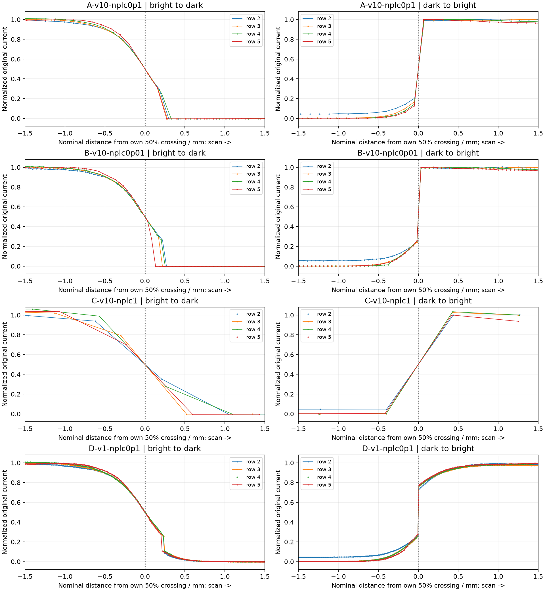

# 边缘伪影复核：排除首行

用户指出首行可能扫到倾斜胶带边缘并因有限光斑漏光。首行应从方向性伪影分析中排除；此前把首行宽缓渐变作为主要判断证据，分析重点不当。首行观察不能用来否定后续边缘的动态或量程伪影。

图中仅使用第2–5行原始电流，每条边按自身50%电平位置居中。横坐标沿正扫方向增加，采用估计的名义毫米尺度；居中消除了绝对边缘位移，不能据此判定真实边界前后偏移。左右面板分别是长条区域进入暗区和离开暗区的过渡，不是正向与反向扫描。点为原始样本，连线仅帮助阅读。

## 本次复核观察

- A/B的亮→暗过程较宽缓，暗→亮过程更突兀；第2–5行形状重复性较强，确有值得关注的转换不对称。不能只用全图或平均边缘宽度概括。
- D慢速组仍可见突变与缓变并存，不能说慢速没有边缘异常。
- C组边缘原始样本过少，连线呈现的斜坡不能可靠用于尾部形状判断。
- 明显突变不等于已确认自动量程；器件响应、采集链路、光学边缘等仍需区分。固定采样点间距的空间映射也可能因实际采样间隔变化而失真。
- 本批均为单向扫描；不同实体边缘的上升/下降不对称，不等于已经证明伪影随方向反转。检验方向性应比较同一实体边界在正扫和回扫中的轮廓。本次回程原始数据尚未在这份补充中分析。

10%–90%宽度仅供辅助（后四行中位数，名义mm）：

|组|亮→暗|暗→亮|
|---|---:|---:|
|A|0.748|0.202|
|B|0.702|0.255|
|C|1.230|0.658|
|D|0.758|0.542|

这些宽度不能代表绝对定位精度，也不能代替对突变位置、低幅尾部和方向翻转的检查。尤其D的缓尾使宽度更大，不应据此认定慢速成像更差。

汇报修改：排除首行几何漏光干扰，重点呈现后四行两类边缘。结果显示稳定的转换不对称，但现有单向比较不足以确定方向翻转规律及其源表机制。上一版首行图保留为数据记录，不再作为否定方向性伪影的主要证据。

[零点附近局部斜率及逐行数据](edge-slopes.md)
