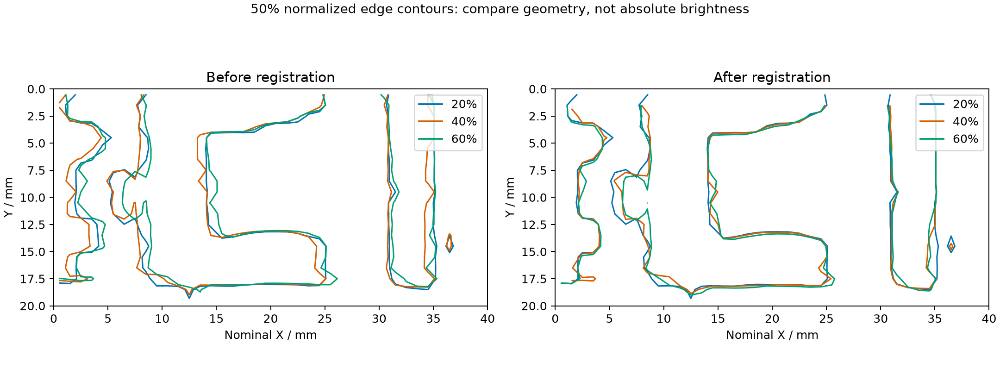
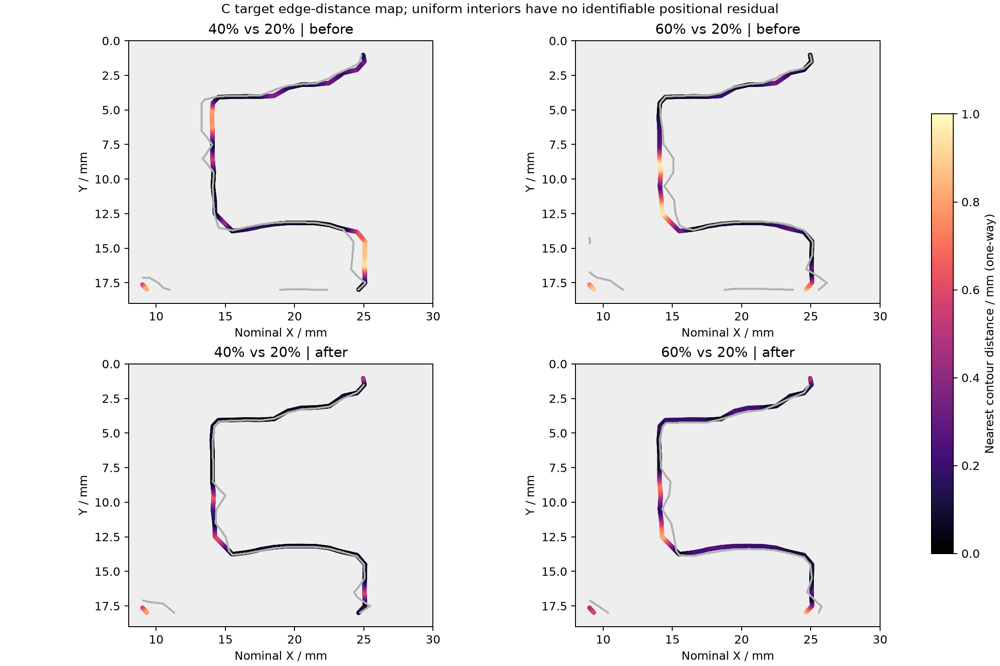
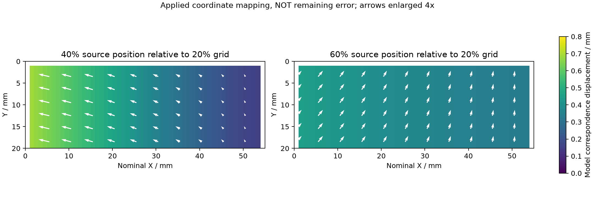

# 第四个问题：三次测量对准与逐像素融合

## 明确结论

已实现三次测量向同一空间网格的映射及原始电流追溯，可完成本次融合流程可行性验证。Marker配准改善主要轮廓，但存在局部残差；不等于真实偏振反演已完成或每像素位置误差均已测得。不要求继续开展一整套实验来结束本次流程验证。

## 原来的六幅图

[原图](comparisons/05_registration_common_grid.png)上排为三次独立重构，下排为以20%为参考，根据Marker拟合的平移与水平尺度变化，将公共像素覆盖范围映射回原始数据后重新汇总的结果。共用色标保留真实电流差异；不是把三幅图亮度拉成一样。公共有效像素1007/1100，无覆盖处为空。

## 建议汇报三页

### 第一页：三次独立测量和直接叠加

展示原来的三张独立图，附[RGB直接叠加前后](comparisons/08_rgb_overlay.png)。显示专用归一化后将20%、40%、60%分别放入R/G/B通道；白色表示三组均亮、黑色表示三组均暗，彩色区域表示形状或相对响应差异。彩边不是纯位置误差，不能据颜色直接读毫米。导出的电流不归一化。

### 第二页：轮廓重合和剩余位置差异

提取每幅显示归一化图的50%等值轮廓，三色代表三次测量，比较配准前后。阈值只用于几何展示，不用于原始电流成像或融合。

上排对准前，下排对准后；颜色为20%参考轮廓到另一图最近轮廓的距离，单位为名义mm。黑色接近重合、亮色偏差较大，灰背景不评价。仅选9<x<29、1<y<18区域，和此前未参与拟合的C区域定义一致。边界截断及局部额外轮廓会影响最近距离；这是单向最近轮廓距离，不是同一物质点的已知真位移。等值轮廓也会受局部响应变化影响，因此不是完全独立于电流响应的位移计。

这张热图只在有可识别边界的位置给出差异；均匀亮区/暗区不能凭图像确定每个像素的真实残余位移，不将其补成零误差。

本ROI参考轮廓到目标轮廓距离的90百分位：40%为0.76→0.36 mm，60%为0.72→0.52 mm。中位数分别为0.154→0.048 mm、0.132→0.182 mm。因此较大偏差减小，但60%不是所有部位都改善。数值来自插值轮廓和名义坐标，不代表绝对定位精度。不要与此前特定竖边的0.15/0.16 mm指标混用。

### 第三页：每个像素实际取了哪些数据

这是每个公共像素中心对应到40%或60%原始图位置时的坐标差大小；箭头表示从参考到源坐标的方向，长度放大4倍。它是算法施加的映射，不是对准后剩余误差，更不是独立实测位置。平滑的条带来自全局平移与X尺度模型，不代表逐像素独立测出了位移。

配合[逐像素查看器](comparisons/fusion-viewer.html)，选定同一个公共像素，展示三组原始电流值、原始点索引、行号和跨行权重。原始连续信号按公共像素覆盖范围重新汇总，不要求三组第n个采样点互相对应。公开数据见[公共电流表](comparisons/common_grid_currents.csv)和[原始点追溯表](comparisons/common_pixel_source_intervals.csv)。

## 可直接讲的结论

以外围Marker建立共同坐标，将三次不同照明强度的测量映射到同一网格，保留实际电流并实现原始点追溯。三色轮廓和边缘距离图显示主要几何偏差得到改善，但局部边缘残差仍存在。当前已完成多次测量的数据融合流程验证；后续真实偏振器件到位后，在该流程上加入通道校准和斯托克斯反演。本次不再以完美逐像素重合为结束条件。

复现新增图：`python experiments/2026-10-16/show_registration.py`。
